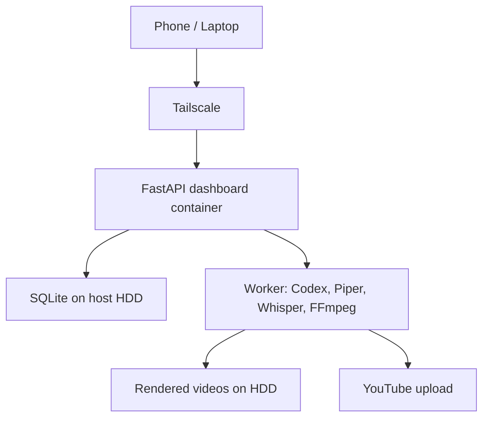

Yes. The entire application can run in Docker on your homelab. For your 4 GB machine, use a small Docker Compose setup with one application container and bind-mounted folders for the 1 TB HDD.



### Recommended container setup

Initially, keep these together:

* Python/FastAPI dashboard
* Background worker
* FFmpeg
* Piper
* whisper.cpp
* Codex CLI

Keep these outside the container:

* SQLite and videos: mounted from your HDD
* Secrets: `.env` or Docker secrets
* Tailscale: installed directly on the homelab OS
* Docker itself: installed on the OS

Example folder layout:

```text
/srv/youtube-agent/
├── compose.yaml
├── .env
├── config/
├── data/
│   └── app.db
├── media/
│   ├── assets/
│   ├── projects/
│   ├── previews/
│   └── finished/
├── credentials/
└── app/
```

Example `compose.yaml`:

```yaml
services:
  youtube-agent:
    build: ./app
    container_name: youtube-agent
    restart: unless-stopped

    ports:
      - "127.0.0.1:8080:8080"

    env_file:
      - .env

    volumes:
      - ./config:/app/config:ro
      - ./data:/app/data
      - ./media:/app/media
      - ./credentials:/app/credentials
      - codex-home:/home/agent/.codex

    environment:
      DATABASE_URL: sqlite:////app/data/app.db
      MAX_CONCURRENT_JOBS: "1"

    mem_limit: 3g
    cpus: 2

    command: >
      uvicorn youtube_agent.main:app
      --host 0.0.0.0
      --port 8080

volumes:
  codex-home:
```

The exact CPU limit should be adjusted according to your homelab CPU.

Your image would install the native tools:

```dockerfile
FROM python:3.12-slim

RUN apt-get update && apt-get install -y \
    ffmpeg \
    curl \
    ca-certificates \
    && rm -rf /var/lib/apt/lists/*

WORKDIR /app

COPY requirements.txt .
RUN pip install --no-cache-dir -r requirements.txt

COPY . .

RUN useradd --create-home --uid 10001 agent \
    && chown -R agent:agent /app

USER agent

CMD ["uvicorn", "youtube_agent.main:app",
     "--host", "0.0.0.0", "--port", "8080"]
```

Piper, whisper.cpp and Codex CLI would also need to be installed in the final image. Their exact installation should be pinned to tested versions when we implement it.

## How you would deploy it

On a Linux homelab:

```bash
sudo mkdir -p /srv/youtube-agent
sudo chown -R "$USER":"$USER" /srv/youtube-agent

cd /srv/youtube-agent

docker compose build
docker compose up -d
docker compose logs -f youtube-agent
```

Open the dashboard locally at:

```text
http://HOMELAB-IP:8080
```

Do not expose port `8080` directly to the public internet.

For phone/laptop access, install Tailscale on:

* Homelab server
* Phone
* Laptop

Then access it through the server’s Tailscale IP:

```text
http://TAILSCALE-IP:8080
```

Because the example binds the container to `127.0.0.1`, you would either run a host reverse proxy for Tailscale access or change the mapping to:

```yaml
ports:
  - "8080:8080"
```

Then use firewall rules to allow only the Tailscale interface. A reverse proxy with HTTPS is cleaner for the final setup.

## Codex authentication inside Docker

This is the slightly awkward part. Codex needs persistent authentication, so its configuration directory must survive container recreation:

```yaml
volumes:
  - codex-home:/home/agent/.codex
```

You would perform the initial interactive login from the server:

```bash
docker compose run --rm youtube-agent codex login
```

Once authenticated, later jobs can invoke `codex exec`. Do not copy authentication files into the Docker image or commit them to Git.

One caveat: Plus-based Codex access has usage limits and authentication can occasionally require renewal. Therefore, the dashboard should show `AUTH_REQUIRED` rather than repeatedly retrying failed jobs.

## Important adjustment for 4 GB RAM

I would actually begin with a single container and a single active production job:

```yaml
environment:
  MAX_CONCURRENT_JOBS: "1"
  WHISPER_THREADS: "2"
  FFMPEG_THREADS: "2"
```

Also add 8–16 GB swap on the host. Do not start FFmpeg, Whisper and Piper simultaneously—the worker should execute them sequentially:

```text
generate package → voice → render → captions → final render → upload
```

Later, with more RAM, dashboard and worker can become separate containers.

## SQLite in Docker

SQLite remains appropriate. The important rule is to mount its directory from the host:

```yaml
volumes:
  - ./data:/app/data
```

Never store the database only inside the container because removing the container would remove its writable layer. Back up the database using SQLite’s backup command, not by blindly copying it while writes are occurring.

## My recommendation

Use Docker if your homelab already runs Docker—it will make installation, upgrades and rollback cleaner. The application would be operated with:

```bash
docker compose up -d
docker compose logs -f
docker compose pull
docker compose up -d --build
```

For the first implementation, I would use:

* One custom application image
* One active job at a time
* Host-mounted SQLite and media directories
* Tailscale installed on the host
* No publicly exposed ports
* Persistent Codex authentication volume
* Automatic container restart
* A memory limit so FFmpeg cannot freeze the whole server

So yes: the design is Docker-compatible, and Docker Compose is probably the cleanest way for you to run and maintain it from your laptop or phone.
