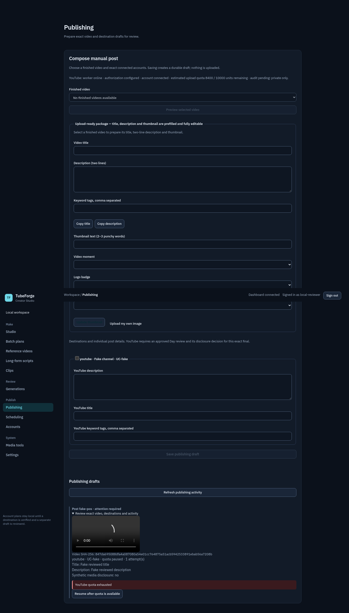
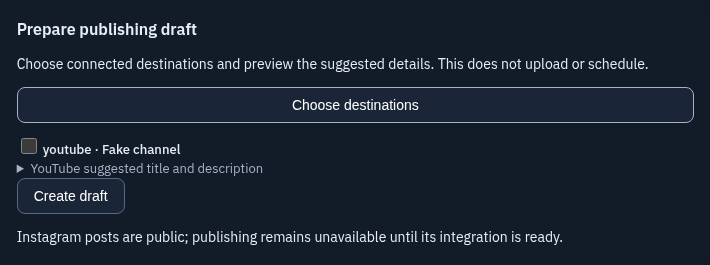

# TubeForge

TubeForge is a self-hosted video production workspace for creating and reviewing vertical Shorts and clips. It combines a Creator Studio dashboard, a job queue, local media processing and optional publishing integrations.

A typical Short starts with a brief, moves through script review and preview approval, and produces a final video for review. The Clips workflow finds candidate moments in a longer source and renders vertical clips. Publication requires separate review and approval.

## Creator Studio

The screenshots below show an isolated demo with sample accounts and publishing data.



The review screen can prepare a destination draft from an approved video.



## What you can do

- Create 30–120 second Shorts with local narration, captions, visuals and audio.
- Turn supported long videos into clips with transcript-based selection and vertical framing.
- Manage topics, schedules, batch plans and review stages in Creator Studio.
- Prepare reviewed publishing drafts and schedule eligible private YouTube deliveries.
- Inspect job state, stage timings and stored application logs.

The YouTube delivery path has fake-service test coverage and has not yet been verified with a live upload. Instagram account connection is implemented, while Instagram publishing remains disabled pending delivery adapter and confirmation-gate integration. Live account connections require platform configuration.

## Requirements

- Linux host with Docker Engine and the Docker Compose plugin, plus enough disk space for images, models and generated video.
- An interactive terminal for creating the dashboard administrator.
- A Piper voice model and its matching configuration file in `models/`. The default production configuration expects `en_US-lessac-medium.onnx` and `en_US-lessac-medium.onnx.json`. Obtain both from the [Piper voice repository](https://huggingface.co/rhasspy/piper-voices/tree/main/en/en_US/lessac/medium).
- For script generation, a separately configured and authenticated Codex or Claude host runner. The containers do not include the operator's CLI login. See [runner deployment](docs/deploy/codex-runner-runtime.md) and [Claude runner service](docs/deploy/tubeforge-claude-runner.service).
- Optional features may need additional local voice and alignment models. Paths and provider settings are in [production configuration](config/production.yaml).

## Get started

Run these commands on the machine that will host TubeForge:

```bash
git clone https://github.com/uditaswal/TubeForge.git
cd TubeForge
mkdir -p data models
cp .env.example .env
```

Place the Piper model and its `.onnx.json` file in `models/`. Edit `.env` for any integrations you intend to use. The sample Pixabay value is a placeholder and should be replaced with a valid key or left empty.

Build the image and start the services:

```bash
docker compose build
docker compose up -d web worker scheduler publisher-worker
docker compose ps
```

Compose runs the database migration and starts the Piper service as dependencies. Wait for Piper to become healthy and the web service to start. Create an administrator and enter a password at the prompt:

```bash
docker compose exec web python -m tubeforge.cli create-admin --username your-name
```

Open <http://127.0.0.1:62065> and sign in. The dashboard binds to the host loopback interface. If the server is remote, open a tunnel on your own computer and keep it running:

```bash
ssh -N -L 62065:127.0.0.1:62065 your-server
```

Then open the same dashboard address on your computer. Configure and start a host runner before submitting a script generation job. The Docker dashboard can be used to inspect jobs and settings independently of runner setup.

## Creator Studio workflow

1. Create a generation from a topic and brief, or queue work through a batch plan or schedule.
2. Review the generated script and approve the exact version you want to render.
3. Review the preview, approve it, and inspect the final video and quality checks.
4. For a clip, review each selected moment and approve the exact clip before preparing a publishing draft.
5. Connect an eligible destination, review the draft and separately approve the exact post before delivery.

Clipping, upload preparation and scheduling have different provider and account requirements. See [Clips](docs/clips.md), [batch plans](docs/batch-plans.md), and [platform integrations](docs/operations/platform-integrations.md).

## Accounts and publishing

For YouTube, create a Google Cloud OAuth client, enable YouTube Data API v3 in the same project, configure the callback and add test users when the app is in testing mode. Set the Google OAuth values and account encryption key in `.env`. The account encryption key must be retained to read saved credentials. Complete Google consent and confirm the exact channel in Studio.

Instagram requires a Meta app configured for Instagram Login, a Professional account, the required permissions and a browser-reachable HTTPS callback. Account connection and Instagram publishing are separate stages. The current publishing worker does not enable Instagram delivery. See [platform integrations](docs/operations/platform-integrations.md) for details and current limitations.

## Logs and troubleshooting

Application logs are stored in `data/logs/`. The web service records dashboard and account connection activity, the worker records pipeline activity, and the scheduler, publisher and Claude runner each have their own logs.

```bash
docker compose ps -a
curl -fsS http://127.0.0.1:62065/healthz
tail -n 100 data/logs/web.log
tail -n 100 data/logs/worker.log
docker compose logs --tail=100 web
```

Logs rotate at 10 MiB by default, with rotated files retained for five days. `TUBEFORGE_LOG_DIR`, `TUBEFORGE_LOG_MAX_MB`, `TUBEFORGE_LOG_RETENTION_DAYS` and `TUBEFORGE_LOG_LEVEL` configure each process. Job events are stored in `data/tubeforge.db`. Clip jobs also keep timings, progress and decision records under `data/artifacts/<job-id>/clip-work/`. See [logging](docs/operations/logging.md).

If the dashboard cannot be reached, check Docker, `docker compose ps -a`, the server-side health check and the SSH tunnel in that order. If Piper is unhealthy, check the model and sidecar paths. If Google reports that its API is not configured, enable YouTube Data API v3 in the project that owns the OAuth client.

## Development

```bash
python -m venv .venv
. .venv/bin/activate
pip install -e '.[dev]'
python -c "import tiktoken; tiktoken.get_encoding('o200k_base')"
python -m alembic upgrade head
python -m pytest
```

Install the optional extras needed for your workload. On hosts with a small RAM-backed `/tmp`, run tests through `scripts/with_disk_tmp.sh`. Configuration is under `config/`, and `TUBEFORGE_CONFIG` selects the configuration file.

## Documentation

| Topic | Guide |
| --- | --- |
| Documentation index | [docs/README.md](docs/README.md) |
| Clips | [docs/clips.md](docs/clips.md) |
| Batch plans and review | [docs/batch-plans.md](docs/batch-plans.md) |
| Reference video intake | [docs/operations/reference-intake.md](docs/operations/reference-intake.md) |
| Long-form scripts | [docs/operations/long-form-scripts.md](docs/operations/long-form-scripts.md) |
| Account and platform setup | [docs/operations/platform-integrations.md](docs/operations/platform-integrations.md) |
| Settings | [docs/settings.md](docs/settings.md) |
| Logging | [docs/operations/logging.md](docs/operations/logging.md) |
| Security | [SECURITY.md](SECURITY.md) |

The application is organised under `src/tubeforge/`, with the dashboard in `api/`, job orchestration in `pipeline/`, workers in `workers/`, and media rendering in `rendering/`. Database migrations are in `migrations/` and automated tests are in `tests/`.
